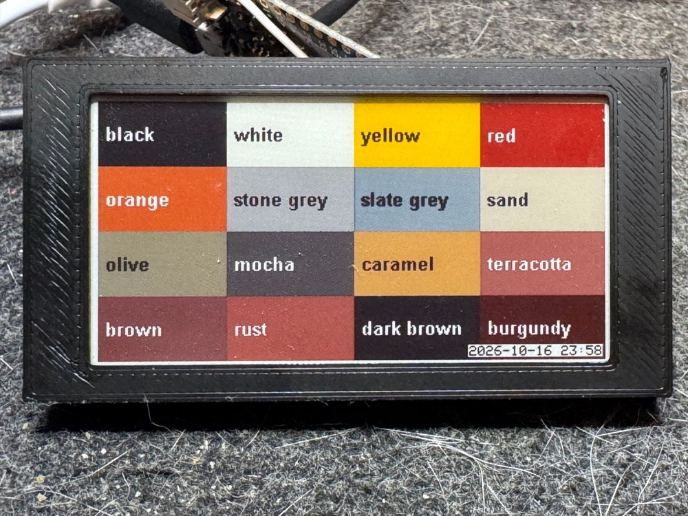

This is a universal firmware for ESP32/ESP32-S2 devices to connect an ePaper display (with an SPI connection) to OpenEpaperLink.
The software is designed to be compiled using VSCode/PlatformIO.

Currently, it includes drivers for the following displays:

- 7,3" Spectra 6 color Epaper Display (buy it here: https://s.click.aliexpress.com/e/_oDk19jD)
- 4.01" ACeP color Epaper Display (discontinued)
- 2.66" e-Paper (G), 360x184, black/white/yellow/red (Waveshare raw panel), also in a 16-colour mode (see below)

Select the display type in `/include/main.h`, or pick one of the environments in `platformio.ini`. It's relatively easy to add support for other display types, as long as they use SPI and you have the code to send an image buffer to the display. If you add support for a new display type, feel free to submit a pull request so others can benefit from your work.

When ordering a display, make sure to include an adapter board to access the SPI pins. Avoid purchasing an "ESP32 demo kit" with it, as it is not necessary.
In addition to the ePaper display and adapter board, you'll need an ESP32. For larger or full-color displays, PSRAM is required. A Wemos S2 mini (buy it here: https://s.click.aliexpress.com/e/_oFBoFr1) 
with 2 MB of PSRAM works well and is very affordable.

Connecting the pins is straightforward. You can use a header connector instead of wires. Refer to the pinout in `platformio.ini` to determine which pin numbers to use.

⚠️ Since the bare displays are **very fragile**, it is highly recommended to provide some protection as a first step. A basic 3D-printed case for the 7.3" Spectra display is also included in this repository. It consists of a bezel and an inset. No printing supports needed.

To add rigidity, the case is designed to embed a 9x15 cm prototype board (buy it here: https://s.click.aliexpress.com/e/_oDEHPhz), which can be incorporated during the printing process.
Configure your slicer to pause the print just before the bridges are printed, insert the prototype board, and then resume printing.

## 2.66" e-Paper (G): four colours or 16 colours

Two PlatformIO environments drive this panel (pins as in `lolin32_lite`):

- `lolin32_lite_2in66g`: the panel's own waveform (OTP), black/white/yellow/red, hwType `0xFE`.
- `lolin32_lite_2in66g16`: 16 colours without dithering, hwType `0xFD`. The image is shown in three refreshes (about 24 s at room temperature):
  the first sets a base colour (orange, white, yellow or red), the second and third edit it (to black, keep, lighter, darker) at two drive voltages.
  The 16 combinations are the most distinct ones of the 64 possible, measured with a webcam:
  black, white, yellow, red, orange, stone grey, slate grey, sand, olive, mocha, caramel, terracotta, brown, rust, dark brown and burgundy.
  Blue, green and pink are not possible with this ink.

The AP needs the matching tag type file. Upload `tagtypes/FD.json` (16 colours) or `tagtypes/FE.json` (four colours) to `/tagtypes/` on the AP,
for example with the file editor of the AP or with
`curl --form 'data=@tagtypes/FD.json;filename=/tagtypes/FD.json;type=application/json' http://<ap address>/edit`.
The colour table in `FD.json` holds the measured colours, in the order of the palette indices the firmware expects.

The 16-colour mode loads its own waveforms into the controller (a JADARD JD7966x) instead of using the factory waveform in its MTP.
The firmware reads the panel's temperature sensor and picks one of ten temperature bands; only room temperature has been tested.

### Sources

- Display driver: the Waveshare e-Paper library, `EPD_2in66g` (https://github.com/waveshareteam/e-Paper).
- Waveforms (`include/EPD_2in66g_waves.h`): the factory waveforms of a 2.66" BWRY electronic shelf label,
  recovered and published by Gerard780 (https://github.com/gerard780), together with the two-refresh method and the discovery
  of the extra colours (orange and greys) on that label. His firmware work builds on ATC1441's ATC_BLE_OEPL firmware.
- Controller registers (power settings, LUT selection, border, MTP): the JADARD JD79661AA datasheet.
- The third refresh, the drive voltages per refresh and the choice of the 16 colours were worked out for this panel with a webcam.

(Some of the links in this documentation are affiliate links. This means that if you click on the link and make a purchase, a small commission may be earned at no additional cost to you)
